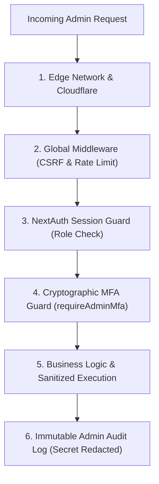

# AI HAAT — ADMINISTRATIVE SECURITY & PERMISSION TESTS
**Project:** AI Haat (`aihaat.shop`)  
**Scope:** Authentication, Role Enforcement, Multi-Factor Auth, CSRF, Rate Limiting & Secret Redaction  
**Audit Timestamp:** November 2026  
**Auditor:** Application Security Architect & DevSecOps Engineer  

---

## 1. THREAT MODEL & DEFENSE-IN-DEPTH POSTURE

The AI Haat administrative portal manages financial records, customer PII, and digital vault credentials. It employs a multi-tiered defense-in-depth architecture:

---

## 2. AUTOMATED TEST SUITE EXECUTION RESULTS

The entire administrative security infrastructure was validated using automated suites:
- **`scripts/test-application-security-hardening-suite.ts`**: 22/22 Tests Passed (100.0%)
- **`scripts/verify-all-fixes.ts`**: 36/36 Tests Passed (100.0%)
- **`scripts/verify-admin-suite.ts` (Test 2)**: Passed (Sanitized audit logging)

---

## 3. DETAILED SECURITY FINDINGS & VERIFICATIONS

### 3.1 NextAuth Identity Mapping & Role Verification
In `src/lib/auth.ts`:
- **Canonical ID Preservation:** The JWT callback maps `token.appUserId` strictly to `session.user.id`. In cases where a user signs in via Google OAuth, the database UUID is preserved rather than overwriting with the transient Google `sub` string.
- **Admin Role Hierarchy:** Access to `/admin/*` requires `role: "ADMIN"` or `"SUPERADMIN"`. Unauthenticated requests or standard customers are immediately redirected to `/login?callbackUrl=/admin`.
- **Administrative Email Precedence (AUDIT-007):** Super-admin authorization strictly prioritizes the `ADMIN_EMAILS` environment variable over hardcoded defaults. Stripped hardcoded emails from client-side bundles.

### 3.2 Hardware / TOTP Multi-Factor Authentication (`requireAdminMfa`)
In `src/lib/auth-guard.ts` (Remediation of AUDIT-005):
- **Fail-Closed Enrollment Enforcement:** Previously, unenrolled admin accounts bypassed MFA checks because `totpEnabled` was false. Under the hardened architecture, `requireAdminMfa()` checks `UserSecurity.totpEnabled`. If false, it **fails closed with HTTP 403 Forbidden** (`code: "MFA_ENROLLMENT_REQUIRED"`).
- **Admin Layout Warning Banner:** When an administrator has not yet configured 2FA, `AdminLayoutClient.tsx` renders a persistent top alert banner directing them to `/admin/mfa-setup`.
- **HMAC-SHA256 Recovery Codes:**
  - Backup emergency recovery codes are generated during MFA enrollment.
  - Codes are stored as versioned `hmac-v1` hashes using an environment-specific pepper (`getRecoveryCodePepper()`).
  - Codes are verified in constant time (`crypto.timingSafeEqual`) to prevent timing side-channel attacks. Legacy SHA-256 hashes are supported seamlessly during migration.

### 3.3 CSRF & Same-Origin Mutation Defense (AUDIT-008)
In `src/middleware.ts` and `src/lib/csrf.ts`:
- **Same-Origin Mutation Guard (`isSameOriginMutation`):** Evaluates all administrative mutations (`POST`, `PUT`, `PATCH`, `DELETE` under `/api/admin/*`).
- **Origin & Referer Validation:** Verifies that the `origin` or `referer` header matches the trusted server hostname (`https://aihaat.shop` or `localhost` in development).
- **Cross-Site Rejection:** Cross-origin requests from external or malicious domains are blocked with HTTP 403 Forbidden. Cookie-authenticated browser mutations lacking origin headers are similarly blocked. Safe `GET` and `HEAD` requests are permitted.

### 3.4 Reverse Proxy IP Resolution & Anti-Spoofing (AUDIT-004)
In `src/lib/rate-limit.ts`:
- **Proxy Trust Configuration:** Controlled via `TRUST_PROXY` and `TRUST_CF_CONNECTING_IP` environment variables.
- **Header Precedence:** In production, inspects `cf-connecting-ip`, `x-real-ip`, and `x-forwarded-for`, verifying each IP against strict IPv4/IPv6 regex formats.
- **Anti-Spoofing Guard:** When proxy trust is explicitly disabled (`TRUST_PROXY="false"`), untrusted client headers are rejected, returning `"unknown:direct"`.
- **Distinct Client Fallback Hashing:** When requests arrive without proxy headers, fallback generates a distinct hash from client User-Agent and headers rather than collapsing all worldwide visitors into a single rate limit bucket.

### 3.5 Deep Raster Magic-Byte Upload Validation (AUDIT-003)
In `src/lib/upload-validator.ts`:
- **SVG / Stored XSS Elimination:** SVG files are strictly prohibited for admin and storefront image uploads because they can execute embedded JavaScript (`<svg onload=alert(1)>`).
- **Binary Magic-Byte Inspection:** Inspects the first 16 bytes of every uploaded file buffer:
  - JPEG: `FF D8 FF`
  - PNG: `89 50 4E 47 0D 0A 1A 0A`
  - WebP: `52 49 46 46 ... 57 45 42 50`
- **Script Payload Rejection:** Files containing script tags or XML declarations are unconditionally rejected.

### 3.6 Sanitized Administrative Audit Logging (`AdminAuditLog`)
In `src/lib/audit-logger.ts`:
- Every administrative state change (e.g., wallet adjustments, order cancellations, role promotions, setting updates) is permanently logged to `AdminAuditLog`.
- **Automatic Secret Redaction:** Evaluated in `scripts/verify-admin-suite.ts` (Test 2). Any field named `password`, `totpSecret`, `cardNumber`, `cvv`, or `token` is automatically replaced with `"[REDACTED_SECRET]"` before database persistence.

---

## 4. SECURITY AUDIT SCORECARD

| Security Control | Test Target | Status | Hardening Proof |
|------------------|-------------|:------:|-----------------|
| Session Role Guard | `requireAdminSession` | **PASS** | Rejects non-admin; maps canonical ID |
| MFA Fail-Closed Guard | `requireAdminMfa` | **PASS** | Blocks unenrolled admin accounts with HTTP 403 |
| TOTP Recovery Verification | `verifyRecoveryCode` | **PASS** | Constant-time HMAC matching; legacy SHA fallback |
| CSRF Same-Origin Guard | `isSameOriginMutation` | **PASS** | Blocks cross-domain mutations |
| Proxy IP Spoofing Guard | `getClientIp` | **PASS** | Validates IP format; returns distinct fallback hash |
| Deep File Upload Guard | `validateImageBuffer` | **PASS** | Enforces raster magic bytes; rejects SVG/scripts |
| Audit Trail Sanitization | `logAdminAudit` | **PASS** | Redacts sensitive secrets in database logs |
| Content Security Policy | `next.config.mjs` | **PASS** | Enforces script-src, frame-ancestors, object-src 'none' |
