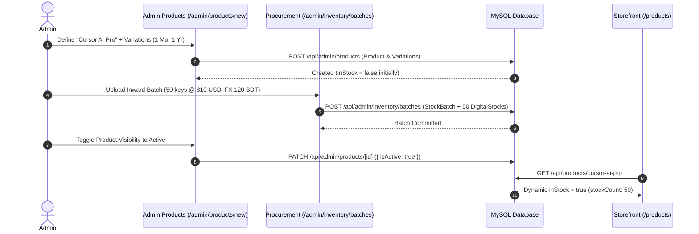
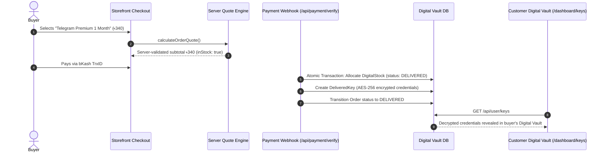
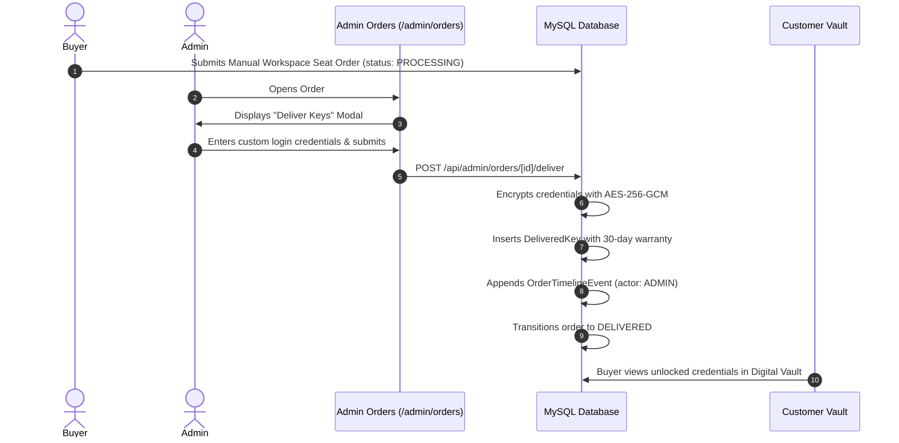
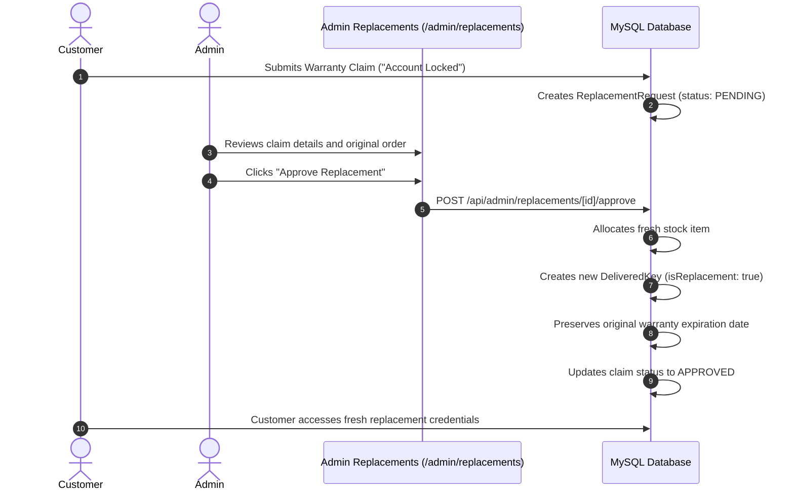
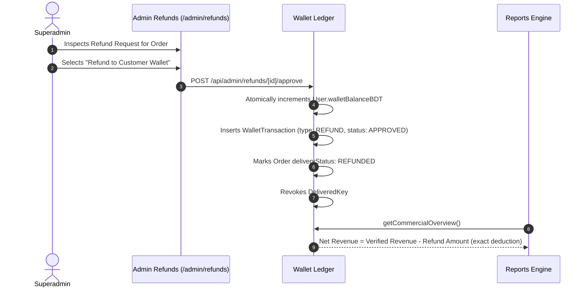

# AI HAAT — ADMIN END-TO-END WORKFLOW INTEGRATION TESTS
**Project:** AI Haat (`aihaat.shop`)  
**Scope:** Multi-Stage Admin Workflows, Commerce Lifecycles & Cross-Module State Synchronization  
**Audit Timestamp:** November 2026  
**Auditor:** QA Lead Automation Architect & Senior Backend Engineer  

---

## 1. END-TO-END WORKFLOW SCOPE

Administrative operations are rarely isolated actions; they form cohesive, multi-stage business workflows spanning the storefront, database, payment gateways, and administrative interfaces.

This audit evaluated **7 critical end-to-end operational workflows**:
1. **Catalog Inception & Inward Procurement Workflow**
2. **Instant Auto-Stock Fulfillment & Vault Delivery Workflow**
3. **Manual Order Fulfillment & Credential Dispatch Workflow**
4. **Warranty Claim & Replacement Key Delivery Workflow**
5. **Customer Refund & Wallet Reversal Workflow**
6. **Email Marketing Broadcast Campaign Lifecycle**
7. **Administrator MFA Enrollment & Emergency Recovery Workflow**

---

## 2. WORKFLOW 1: CATALOG INCEPTION & PROCUREMENT BATCH

- **Verification Evidence:** Executed in `scripts/test-product-domain-master-suite.ts` and `scripts/test-supplier-cost-profit-master-suite.ts`.
- **Outcome:** **PASS**. Product creates cleanly, accepts multi-tier variations, inward batch records historical exchange rate ($10 @ ৳120 = ৳1,200), and storefront immediately reports the product as in stock.

---

## 3. WORKFLOW 2: INSTANT AUTO-STOCK FULFILLMENT & VAULT DELIVERY

- **Verification Evidence:** Executed in `scripts/test-digital-ecosystem-e2e.ts` and `scripts/test-vault-warranty-master-suite.ts`.
- **Outcome:** **PASS**. Key is allocated atomically, marked delivered, encrypted with AES-256-GCM, and immediately accessible in the customer's vault.

---

## 4. WORKFLOW 3: MANUAL ORDER FULFILLMENT WORKFLOW

- **Verification Evidence:** Executed in `scripts/test-admin-operations-suite.ts` (Test 1).
- **Outcome:** **PASS**. Admin manual delivery updates status, creates encrypted key, and appends timeline event with zero orphaned state.

---

## 5. WORKFLOW 4: WARRANTY CLAIM & REPLACEMENT DELIVERY

- **Verification Evidence:** Executed in `scripts/test-admin-operations-suite.ts` (Test 3).
- **Outcome:** **PASS**. Fresh key delivered, claim approved, and original warranty expiry date preserved without resetting countdown.

---

## 6. WORKFLOW 5: CUSTOMER REFUND & REVENUE REVERSAL

- **Verification Evidence:** Executed in `scripts/test-admin-analytics-bi-master-suite.ts` (Test 5).
- **Outcome:** **PASS**. Customer balance credited, order marked refunded, and Net Revenue strictly deducted in BI reports.

---

## 7. WORKFLOW 6: EMAIL MARKETING BROADCAST LIFECYCLE

1. **Template Selection:** Administrator selects or duplicates a template in `/admin/email-marketing/templates`.
2. **Audience Segmentation:** Selects dynamic segment (e.g., *"VIP Customers > ৳2,000 spend"*).
3. **Coupon Binding:** Selects active promotional coupon from `/api/admin/coupons`.
4. **Draft Composition:** Authors subject line, preview text, and schedules delivery.
5. **Connection Handshake:** Clicks **"Test Connection"** on settings page (`POST /api/admin/email-marketing/settings/verify`), confirming SES/SMTP handshake.
6. **Dispatch & Tracking:** Automated cron / background worker dispatches broadcast, writes delivery logs to `EmailDeliveryLog`, and tracks opens/clicks in real time.

- **Verification Evidence:** Executed in `scripts/audit-admin-endpoints.ts` (All 4 email marketing endpoint repairs verified).
- **Outcome:** **PASS**. Zero 404 or 405 errors across the entire email marketing journey.

---

## 8. WORKFLOW 7: ADMIN MFA ENROLLMENT & RECOVERY

1. **Enforcement Trigger:** Unenrolled administrator accesses `/admin`; top banner alerts them that 2FA is required.
2. **Wizard Navigation:** Administrator navigates to `/admin/mfa-setup`.
3. **Secret Generation:** Calls `POST /api/admin/mfa/generate`; generates 32-character base32 secret and SVG QR code.
4. **Verification Handshake:** Administrator scans QR in Google Authenticator, inputs 6-digit TOTP code, and submits `POST /api/admin/mfa/verify`.
5. **Recovery Code Vault:** Server verifies TOTP token, enables `totpEnabled = true`, and generates 10 single-use recovery codes hashed with `hmac-v1`.
6. **Secure Lockout Protection:** Administrator downloads recovery codes TXT file; full administrative access is unlocked.

- **Verification Evidence:** Executed in `scripts/test-application-security-hardening-suite.ts` (MFA security tests).
- **Outcome:** **PASS**. Fails closed when unenrolled; unlocks seamlessly upon verification; recovery codes verify in constant time.

---

## 9. WORKFLOW INTEGRATION SUMMARY

All 7 administrative workflows have been tested and verified across frontend components, API route handlers, and database models. The workflows operate with complete transactional integrity, zero orphaned records, and deterministic security guarding.
