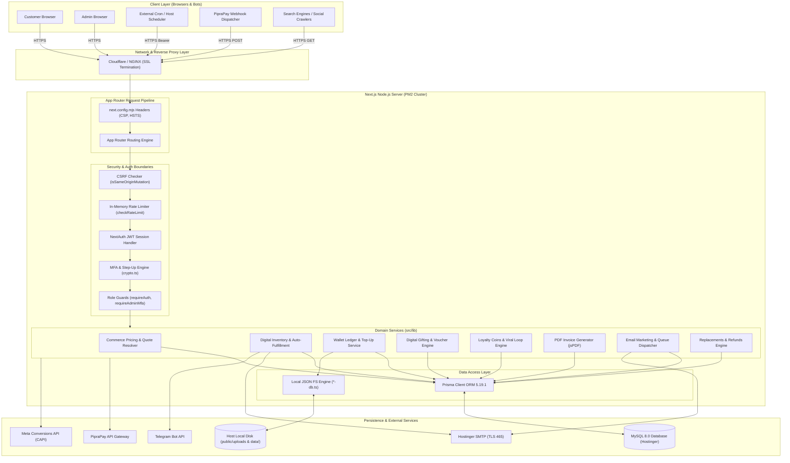
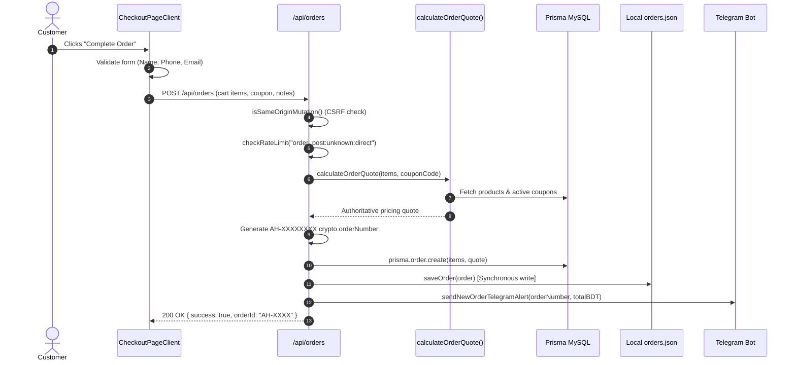
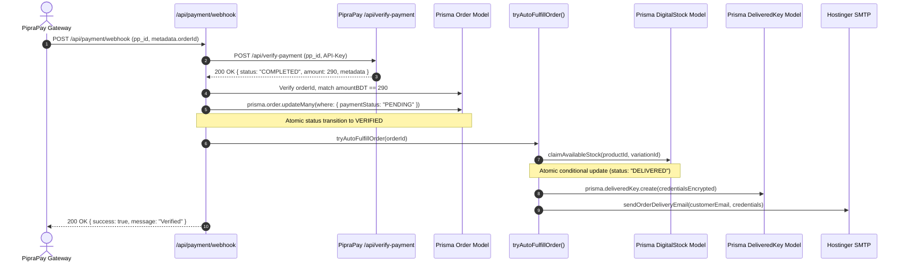

# 01 — PROJECT ARCHITECTURE & SYSTEM DESIGN

## 1. System Inventory & Boundaries

The AI Haat platform is architected as a monolithic web application built on **Next.js 15.5.26 (App Router)** and **React 18.3.1**, powered by **Node.js 20+ LTS** and **MySQL 8.0** via **Prisma ORM 5.19.1**.

### Component Topology

| Boundary / Layer | Technologies & Artifacts | Primary Responsibilities |
| :--- | :--- | :--- |
| **Storefront & Client Area** | Next.js App Router, React 18, Tailwind CSS, Framer Motion, Context API | Product discovery, search, comparison, responsive cart drawer, express checkout, digital vault, gift unboxing, user wallet, after-sales ticketing. |
| **Administration Portal** | `/admin/**`, `AdminLayoutClient`, Lucide React | Catalog management, stock pools, order fulfillment, refund/replacement workflow, affiliate payouts, email marketing automation, business intelligence. |
| **API Endpoints** | 121 route handlers under `src/app/api/**/route.ts` | Serverless-style HTTP API handlers for mutations, webhooks, crons, public queries, authentication, and reporting. |
| **Primary Persistence** | MySQL 8.0 via Prisma ORM 5.19.1 (`58 models`, `35 enums`) | Relational transaction ledger, users, digital stock keys, orders, campaigns, MFA credentials, audit logs. |
| **Secondary (Legacy) Persistence** | Synchronous JSON files on disk (`data/*.json`) via `*-db.ts` | Fallback persistence for orders, wallet balances, users, product requests, and Telegram configuration. |
| **Authentication & Identity** | NextAuth v4 (Google OAuth Provider), TOTP (otpauth), AES-256-GCM | Federated Google sign-in, JWT session cookies, optional admin TOTP MFA, device trust tracking. |
| **Payment Gateway** | PipraPay Gateway API (bKash, Nagad, Rocket, Upay, Visa/Mastercard) | Server-to-server payment generation (`/api/checkout/redirect`), IPN webhook (`/api/payment/webhook`), and return callback (`/api/payment/callback`). |
| **Async Operations & Crons** | Guarded HTTP Cron Endpoints (`/api/cron/**`) pinged via host scheduler | Email campaign dispatch, notification retries, inventory expiry warnings, subscription renewal reminders, abandoned cart recovery. |
| **Ops & Process Manager** | PM2 Cluster Mode (`ecosystem.config.js`), Hostinger Linux VPS | Cluster process load balancing, log aggregation (`logs/pm2-*.log`), zero-downtime reloads. |

---

## 2. Complete Architectural Diagram

---

## 3. Detailed Request and Response Lifecycles

### 3.1 Customer Checkout & Order Creation Flow

### 3.2 Payment Verification & Instant Auto-Delivery Flow

---

## 4. Architectural Fragility & Structural Flaws

### 4.1 Dual-State Persistence Split
The codebase maintains **two parallel database paradigms**:
1. **Authoritative Relational Model:** 58 Prisma models in MySQL (`prisma/schema.prisma`).
2. **Local JSON Flat-File System:** `orders-db.ts`, `wallet-db.ts`, `products-db.ts`, `telegram-db.ts` reading and writing files under `/data/*.json` synchronously using `fs.readFileSync` and `fs.writeFileSync`.

**Critical Problem:** In a PM2 multi-core cluster (`instances: "max"`) or containerized hosting, filesystem writes are **uncoordinated and race-prone**. Worker 1 and Worker 2 simultaneously servicing requests will overwrite each other's `orders.json` and `wallet.json`. Furthermore, whenever a new build is deployed or a container restarts, uncommitted JSON changes on disk are wiped.

### 4.2 In-Memory Cluster Desynchronization
- Rate limits (`src/lib/rate-limit.ts`) reside in an in-memory `Map<string, RateLimitEntry>`. In PM2 cluster mode with $N$ worker processes, rate limits are not shared across workers, creating $N$ distinct memory buckets.
- If a worker crashes or restarts, rate counters reset to zero.
- Crucially, model `RateLimitBucket` was created in Prisma for database-backed rate limiting, but no route handler actually calls or updates it.

### 4.3 Missing Edge Middleware
Next.js 15 supports Edge Middleware (`middleware.ts`) for centralized routing, CSRF enforcement, security header injection, IP resolution, and rate limiting. Currently, AI Haat has **no global `middleware.ts`**. Every security check (CSRF, auth guard, rate limit) is applied piecemeal inside individual route handlers, leading to severe omissions (e.g., admin mutation routes omitting CSRF checks).
