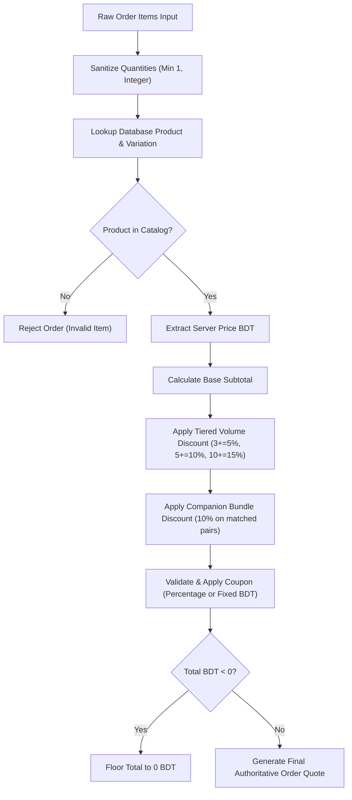

# 08 — BUSINESS LOGIC & DATA CONSISTENCY AUDIT

This audit reviews commercial business rules, financial calculations, discount stacking, state transitions, and concurrency guarantees across the AI Haat ecosystem.

---

## 1. Commerce Calculation Engine

### 1.1 Server-Authoritative Price Quote Calculation
All client checkout calculations are validated server-side by `calculateOrderQuote()` in `src/lib/commerce/pricing.ts`.



- **Invariants Verified:**
  - Client-supplied prices and totals are completely ignored in `POST /api/orders`.
  - Stacking priority: Base Price $\rightarrow$ Volume Pricing $\rightarrow$ Bundle Discount $\rightarrow$ Coupon Discount.
  - Floating-point addition and subtraction are mediated by `safeAddBDT`, `safeSubBDT`, `safeMulBDT` in `src/lib/commerce/money.ts`.

---

## 2. Loyalty Coins & Rewards Mechanics (`src/lib/loyalty/coins.ts`)

- **Earning Rules:**
  - 1 AI Haat Coin earned per 10 BDT spent on completed, verified orders:
    $$\text{Coins Earned} = \lfloor \frac{\text{Order Total BDT}}{10} \rfloor$$
- **Redemption Tiers:**
  - Bronze Voucher: 100 Coins $\rightarrow$ 20 BDT Discount Coupon
  - Silver Voucher: 250 Coins $\rightarrow$ 60 BDT Discount Coupon
  - Gold Voucher: 500 Coins $\rightarrow$ 150 BDT Discount Coupon
  - Platinum Voucher: 1,000 Coins $\rightarrow$ 350 BDT Discount Coupon
- **Concurrency & Ledger Check:**
  - When a user claims a coupon with coins (`claimCouponWithCoins`), the system executes a Prisma transaction that deducts user coin balance with `decrement: tier.coinsCost` and writes an audit entry in `CoinTransaction` with `type: "REDEEM_COUPON"`.
  - A unique discount coupon is generated with format `COIN-XXXX-XXXX` and bound to the claiming user's email.

---

## 3. Digital Gift Card Lifecycle (`src/lib/gifting/gift-cards.ts`)

- **State Machine:**
  ```mermaid
  stateDiagram-v2
      [*] --> ACTIVE: Created via Admin or Purchase
      ACTIVE --> REDEEMED: User inputs code into /dashboard/wallet
      ACTIVE --> EXPIRED: Validity period exceeds 365 days
      ACTIVE --> CANCELLED: Revoked by Administrator
      REDEEMED --> [*]
      EXPIRED --> [*]
      CANCELLED --> [*]
  ```
- **Code Format:** Branded 16-character code: `AIHT-XXXX-XXXX-XXXX` (12 hex digits generated with `crypto.randomBytes(6)`).
- **Concurrency & Re-entrancy Guard:**
  - In `redeemGiftCardToWallet()`:
    ```typescript
    const [updatedUser, updatedCard] = await prisma.$transaction([
      prisma.user.update({
        where: { id: userId },
        data: { walletBalanceBDT: { increment: amountToCredit } },
      }),
      prisma.giftCard.update({
        where: { id: giftCard.id },
        data: { status: "REDEEMED", currentBalanceBDT: 0, redeemedByUserId: userId, redeemedAt: new Date() },
      }),
      prisma.walletTransaction.create({
        data: {
          userId,
          amountBDT: amountToCredit,
          type: "DEPOSIT",
          method: "gift_card",
          senderNumber: giftCard.code,
          trxId: `GC_${giftCard.code.replace(/-/g, "")}`,
          status: "APPROVED",
        },
      }),
    ]);
    ```
  - **Identified Weakness:** `prisma.giftCard.update` lacks a conditional `status: "ACTIVE"` check in `where`. While the unique constraint on `trxId` (`GC_...`) in `WalletTransaction` will cause a second simultaneous request to fail and rollback the transaction, wrapping the status transition in a conditional check (`updateMany({ where: { id: giftCard.id, status: "ACTIVE" } })`) is the recommended atomic defense against race conditions.

---

## 4. Affiliate Attribution & Commission Rules (`src/lib/commerce/affiliates.ts`)

- **Attribution Window:** 30 days via cookie / localStorage tracking.
- **Self-Referral Fraud Guard:**
  - When an order completes, `attributeOrderToAffiliate()` checks if the customer email or customer IP matches the affiliate owner. If a match is detected, the commission is flagged or rejected with reason `SELF_REFERRAL_BLOCKED`.
- **Commission Settlement Lifecycle:**
  - Commission created as `PENDING`.
  - Held in escrow until the product warranty / refund window expires (typically 3–7 days).
  - Transitioned to `APPROVED` and added to affiliate withdrawable balance.
  - When payout is requested, admin executes manual payout via bKash/Nagad and transitions payout status to `COMPLETED`.
