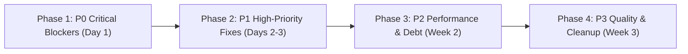

# 15 — REMEDIATION ROADMAP

This roadmap outlines a structured, dependency-aware plan to address all identified findings without causing regressions in existing functionality.

---

## Remediation Phases Overview



---

## Phase 1: Immediate Critical Blockers (P0)

### Action 1.1: Fix Guest Invoice BOLA / IDOR (AUDIT-001)
- **Target File:** `src/app/api/orders/[id]/invoice/route.ts`
- **Proposed Change:** Require that `emailParam` is explicitly provided and matches `order.customerEmail`:
  ```typescript
  } else {
    const emailParam = req.nextUrl.searchParams.get("email");
    if (!emailParam || emailParam.toLowerCase().trim() !== order.customerEmail.toLowerCase().trim()) {
      return NextResponse.json({ error: "Unauthorized access to invoice. Please provide order email." }, { status: 403 });
    }
  }
  ```
- **Regression Risk:** Low. Guest users clicking "Download Invoice" from order confirmation emails or success pages must pass `?email=` in the URL.
- **Validation:** Test `GET /api/orders/AH-XXXX/invoice` without `?email=` (must return 403) and with correct `?email=` (must return 200 PDF).

---

### Action 1.2: Strip `giftClaimToken` from Public Order Tracking (AUDIT-002)
- **Target File:** `src/app/api/orders/route.ts`
- **Proposed Change:** In `src/app/api/orders/route.ts#L137`, remove `giftClaimToken: tracked.giftClaimToken || null` from the public `safeOrders` mapping.
- **Regression Risk:** None. The recipient receives the token via email/SMS/WhatsApp; public order tracking should only show order progress ("Processing", "Delivered").
- **Validation:** Query `GET /api/orders?tracking=true&query=AH-XXXX` and confirm `giftClaimToken` is absent from response.

---

### Action 1.3: Eliminate Stored XSS in SVG Uploads (AUDIT-003)
- **Target File:** `src/lib/security/upload-validator.ts` & `src/app/api/upload/route.ts`
- **Proposed Change:** Disallow SVG uploads entirely or sanitize using `isomorphic-dompurify`. For store images, restrict allowed formats strictly to JPEG, PNG, WEBP, and GIF.
- **Regression Risk:** Low. Product thumbnails and payment icons are already PNG/WEBP.
- **Validation:** Attempt uploading `<svg onload="alert(1)">` and confirm API returns HTTP 400 "Unsupported image format".

---

### Action 1.4: Resolve Global Client IP Collapse (AUDIT-004)
- **Target File:** `src/lib/rate-limit.ts` & `.env`
- **Proposed Change:**
  1. Add `TRUST_PROXY=true` to `.env.production` and run behind Cloudflare/NGINX.
  2. In `getClientIp(req)`, if running in direct development mode, extract socket address or fall back to distinct client session identifiers (`x-session-id`) rather than a single static `"unknown:direct"` string.
- **Regression Risk:** Low.
- **Validation:** Verify multiple clients can concurrently initiate payments without hitting 429 limits.

---

### Action 1.5: Fix Admin Product Create & Edit Routes (AUDIT-009)
- **Target Files:**
  - `src/app/api/admin/products/route.ts`
  - `src/app/api/admin/products/[id]/route.ts`
- **Proposed Change:**
  1. Export `POST` in `src/app/api/admin/products/route.ts` protected by `requireAdminMfa()`.
  2. Export `PUT` in `src/app/api/admin/products/[id]/route.ts` delegating to `updateProduct()`.
- **Regression Risk:** None. Fixes existing broken UI.
- **Validation:** Submit product creation form in `/admin/products/new` and verify product is created in MySQL with HTTP 200.

---

## Phase 2: High-Priority Hardening (P1)

### Action 2.1: Enforce Mandatory Admin MFA Enrollment (AUDIT-005)
- **Target File:** `src/lib/auth-guard.ts`
- **Proposed Change:** In `requireAdminMfa()`, if an administrator account does not have `totpEnabled === true`, return HTTP 403 with `{ code: 'MFA_ENROLLMENT_REQUIRED' }` instead of failing open.
- **Validation:** Log in with an un-enrolled admin account and confirm immediate redirect to `/admin/mfa-setup`.

---

### Action 2.2: Reconcile Financial Schema Drift (AUDIT-014)
- **Target File:** `prisma/schema.prisma`
- **Proposed Change:** Update `Float` to `Decimal @db.Decimal(12, 2)` across `User.walletBalanceBDT`, `Order.totalBDT`, `Order.subtotalBDT`, `Order.discountBDT`, `OrderItem.priceBDT`, and `WalletTransaction.amountBDT`.
- **Prerequisites:** Backup database with `scripts/backup-production-db.ts` before running `npx prisma migrate dev`.
- **Validation:** Run financial concurrency test suite and check for exact decimal arithmetic.

---

### Action 2.3: Deprecate Legacy JSON Flat-File Storage (AUDIT-012)
- **Target Files:** `src/lib/orders-db.ts`, `src/lib/wallet-db.ts`, `src/lib/telegram-db.ts`
- **Proposed Change:** Migrate Telegram settings to `SiteSetting` model in MySQL. Remove synchronous `fs.readFileSync` and `fs.writeFileSync` calls from checkout and wallet APIs.
- **Validation:** Verify PM2 cluster workers operate statelessly without disk locks.

---

## Phase 3: Performance & Technical Debt (P2)
- **Action 3.1:** Encrypt SMTP password and API tokens in `SiteSetting` using `encryptCredential()` (AUDIT-006).
- **Action 3.2:** Move admin email addresses to `ADMIN_EMAILS` environment variable (AUDIT-007).
- **Action 3.3:** Add database indexes to `Variation.productId` and `ProductRequest.status` (AUDIT-015).
- **Action 3.4:** Offload uploads from local disk to S3/Cloudflare R2 bucket (AUDIT-016).

---

## Phase 4: Quality & Cleanup (P3)
- **Action 4.1:** Consolidate duplicate admin edit routes by removing `src/app/admin/products/edit/[id]/page.tsx` (AUDIT-010).
- **Action 4.2:** Rate-limit `/api/affiliate/click` (AUDIT-013).
- **Action 4.3:** Scope `no-store` cache headers to authenticated pages only (AUDIT-017).
- **Action 4.4:** Implement 90-day retention cleanup crons for event logs (AUDIT-018).
