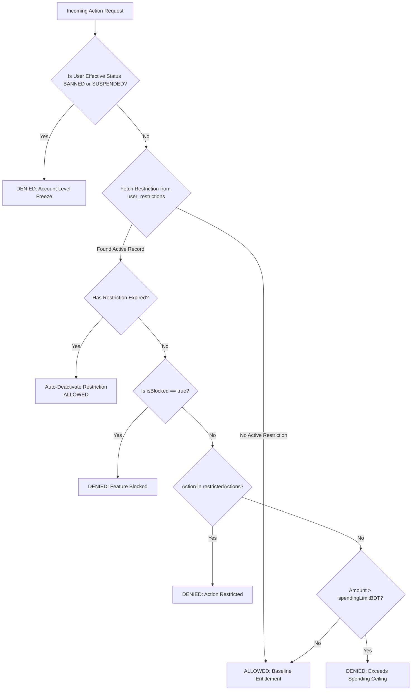

# 04 — FEATURE ENTITLEMENT & RESTRICTION SYSTEM

## 1. Architectural Philosophy

Traditional web applications rely solely on Role-Based Access Control (RBAC), treating authorization as a coarse binary: a user is either a `CUSTOMER` or an `ADMIN`. In digital marketplaces handling high-risk transactions, shared accounts, and warranty licenses, this model fails.

An administrator often needs to:
- Allow a user to browse and view purchased licenses, but **block further checkout**.
- Allow credit card or MFS checkouts, but **prohibit wallet balance debits**.
- Permit product purchasing, but **cap transaction spending at ৳2,000**.
- Allow normal shopping, but **freeze referral commissions** under review.

The **AI Haat Feature Entitlement & Restriction Subsystem** solves this by separating identity roles from granular capability entitlements.

---

## 2. Complete 23-Feature System Registry

The system registers and monitors 23 distinct capabilities across 6 operational domains:

```
┌────────────────────────────────────────────────────────┐
│               AI HAAT FEATURE DOMAINS                  │
├─────────────────┬──────────────────┬───────────────────┤
│ Shopping (5)    │ Financial (4)    │ Digital Goods (6) │
│ - BROWSE        │ - WALLET_ACCESS  │ - LICENSE         │
│ - CART          │ - WALLET_PAYMENT │ - CREDENTIALS     │
│ - CHECKOUT      │ - WALLET_TOPUP   │ - DOWNLOAD        │
│ - PURCHASE      │ - REFUND_REQUEST │ - VAULT           │
│ - INVOICE       │                  │ - GIFT_CLAIM      │
│                 │                  │ - REPLACEMENT     │
├─────────────────┼──────────────────┼───────────────────┤
│ Account (4)     │ Rewards (3)      │ Support (3)       │
│ - LOGIN         │ - COUPON         │ - TICKETS         │
│ - REGISTER      │ - COINS          │ - PRODUCT_REQUEST │
│ - PROFILE_EDIT  │ - REFERRAL       │ - RESTOCK_ALERT   │
│ - RESET_PWD     │                  │                   │
└─────────────────┴──────────────────┴───────────────────┘
```

---

## 3. Restriction Parameters & Capabilities

For every feature, administrators can configure:
1. **Total Block (`isBlocked = true`):** Shuts down the feature entirely for the specified user.
2. **Action-Level Restrictions (`restrictedActions = [...]`):** Restricts specific verbs within a feature domain (e.g. within `SHOPPING_PURCHASE`, restrict `PURCHASE` while allowing `BROWSE`).
3. **Monetary Spending Limits (`spendingLimitBDT`):** Enforces a maximum spend ceiling per transaction. Any attempt to spend above this threshold triggers a denial.
4. **Daily Operation Limits (`dailyLimitCount`):** Caps frequency of actions per rolling 24-hour window (e.g. max 2 replacement requests per day).
5. **Time-Bounded Expiration (`expiresAt`):** Automatically lifts the restriction when the time expires without requiring admin intervention.
6. **Mandatory Audit Reason (`reason`):** Records why the restriction was put in place.

---

## 4. Entitlement Verification Engine

The core authorization function is `checkFeatureEntitlement(userId, featureKey, context)` in `src/lib/user-control/user-control-service.ts`.

### 4.1 Evaluation Logic


---

## 5. Server-Side Enforcement in Production Routes

To guarantee zero bypass, restrictions are enforced in backend route handlers:

### 5.1 Order Checkout (`src/app/api/orders/route.ts`)
```typescript
const entitlement = await checkFeatureEntitlement(session.user.id, "SHOPPING_PURCHASE", {
  action: "PURCHASE",
  amountBDT: finalTotalBDT,
});

if (!entitlement.allowed) {
  return NextResponse.json(
    { 
      error: "FEATURE_RESTRICTED", 
      message: entitlement.reason || "Your ability to complete purchases is currently restricted. Please contact support." 
    },
    { status: 403 }
  );
}
```

### 5.2 Wallet Payment (`src/app/api/wallet/purchase/route.ts`)
```typescript
const entitlement = await checkFeatureEntitlement(session.user.id, "WALLET_PAYMENT", {
  action: "PURCHASE",
  amountBDT: order.totalAmountBDT,
});

if (!entitlement.allowed) {
  return NextResponse.json(
    { 
      error: "FEATURE_RESTRICTED", 
      message: entitlement.reason || "Wallet payments are currently disabled for your account." 
    },
    { status: 403 }
  );
}
```

---

## 6. Database Storage

Backed by the `user_restrictions` table:

```sql
CREATE TABLE IF NOT EXISTS `user_restrictions` (
  `id` VARCHAR(191) NOT NULL PRIMARY KEY,
  `userId` VARCHAR(191) NOT NULL,
  `featureKey` VARCHAR(100) NOT NULL,
  `isBlocked` BOOLEAN NOT NULL DEFAULT TRUE,
  `restrictedActions` JSON NULL,
  `spendingLimitBDT` DECIMAL(12,2) NULL,
  `dailyLimitCount` INT NULL,
  `reason` TEXT NOT NULL,
  `appliedByAdminId` VARCHAR(191) NOT NULL,
  `appliedAt` DATETIME(3) NOT NULL DEFAULT CURRENT_TIMESTAMP(3),
  `expiresAt` DATETIME(3) NULL,
  `isActive` BOOLEAN NOT NULL DEFAULT TRUE,
  UNIQUE KEY `idx_user_feature_unique` (`userId`, `featureKey`),
  INDEX `idx_restr_lookup` (`userId`, `isActive`)
) ENGINE=InnoDB DEFAULT CHARSET=utf8mb4 COLLATE=utf8mb4_unicode_ci;
```
