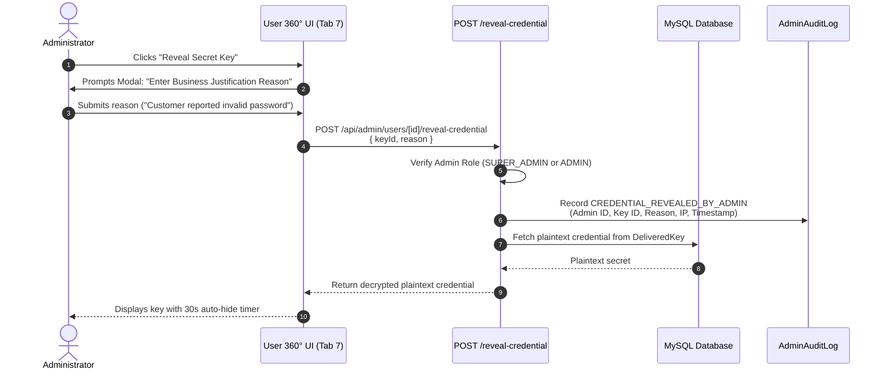

# 07 — ORDER MANAGEMENT & DIGITAL ASSET CONTROL

## 1. Architectural Scope

AI Haat is a specialized digital marketplace delivering software license keys, shared streaming account credentials, and digital game codes. In digital commerce, asset fulfillment differs fundamentally from physical retail: delivery is instant, and delivered credentials represent sensitive, vulnerable secrets.

The User 360° Control Center establishes strict controls over both the financial lifecycle of customer orders and the governance of delivered digital assets.

---

## 2. Order Management Subsystem (Tab 6)

### 2.1 Unified Customer Purchasing Ledger
The Orders tab aggregates all purchase records associated with the user:
- **Order Header:** Order ID, Creation Date, Order Status (`PENDING`, `PROCESSING`, `COMPLETED`, `CANCELLED`, `REFUNDED`), Total Amount (BDT), Payment Method (`BKASH`, `NAGAD`, `WALLET`, `SSLCOMMERZ`).
- **Item Breakdown:** Product titles, variant options (e.g. 1 Month, 1 Screen, Ultra HD), unit prices, quantities, and line item discounts.
- **Payment Verification:** Gateway transaction ID (`trxId`), sender MFS phone number, and settlement timestamps.

### 2.2 Order State Machine Integrity
To preserve financial reconciliation:
- Unpaid orders cannot be manually flipped to `PAID` via arbitrary database toggles. All completions must trace back to an authorized gateway callback or an atomic wallet debit.
- Administrators can cancel eligible `PENDING` orders, releasing reserved digital stock back into the inventory pool.
- Authorized refunds trigger compensating wallet credits or manual gateway refund tracking, creating balanced accounting records.

---

## 3. Digital Asset & Credential Control (Tab 7)

### 3.1 Masked Credential Protection
To defend against insider credential theft or accidental data leakage:
- When the User 360° profile is loaded via `GET /api/admin/users/[id]`, all secret fields (license keys, shared email/passwords, redemption tokens) are strictly masked by the API:
  ```json
  {
    "id": "key_987213",
    "productName": "Canva Pro 1-Year Private",
    "licenseKey": "••••••••••••••••••••••••",
    "deliveryStatus": "DELIVERED",
    "deliveredAt": "2026-11-08T14:30:00Z"
  }
  ```

### 3.2 Audited Credential Reveal Protocol
When an administrator genuinely needs to inspect a delivered credential to assist a customer with a login issue or invalid key complaint:



### 3.3 Replacement & Revocation Workflows
- **Credential Replacement:** If a vendor terminates a shared account prematurely, an administrator can execute an authorized replacement, drawing new stock from `DigitalStock` and updating `DeliveredKey` while archiving the dead credential.
- **Access Revocation:** For disputed or refunded orders, administrators can mark the digital key as `REVOKED`, instantly barring the customer from viewing the credentials in their customer portal.
